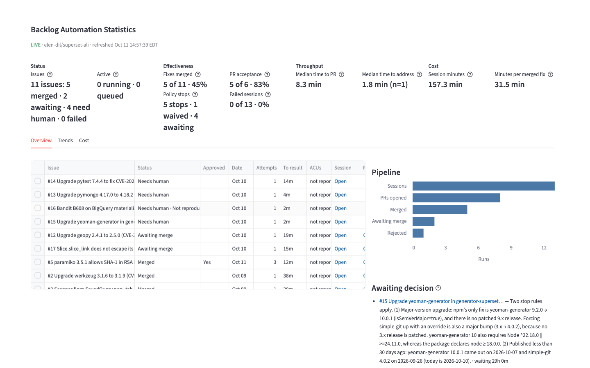

# devin-backlog-autopilot

Every repository has a backlog of small, important fixes that never get
scheduled: dependency CVEs, scanner findings, minor bugs. This service turns
that backlog into pull requests. Apply the label `devin-remediate` to a GitHub
issue and a cloud Devin session reproduces the problem, fixes it, opens a PR,
and reports back on the issue. A human reviews and merges. A dashboard shows
what ran, what shipped, what needs a decision, and what it cost.

Built against a fork of Apache Superset:
[elen-dil/superset-ali](https://github.com/elen-dil/superset-ali) (see its
issues and pull requests for the remediations this produced).



## Quick start

You need Docker (or Python 3.12+ to run without it). Nothing else.

### Try it with no credentials (simulate mode)

Simulate mode swaps in a fake Devin and makes no calls to GitHub, so the whole
pipeline runs locally in about a minute.

```bash
git clone https://github.com/elen-dil/devin-backlog-autopilot
cd devin-backlog-autopilot
cp .env.example .env          # SIMULATE=true is already set
docker compose up --build     # API on :8000, dashboard on :8501
```

In a second terminal, inject a couple of issues:

```bash
# A fix that succeeds and "opens" a PR
curl -X POST localhost:8000/simulate/issue \
  -H 'content-type: application/json' \
  -d '{"number": 1, "title": "demo issue", "body": "fix me"}'

# A fix Devin escalates to a human
curl -X POST localhost:8000/simulate/issue \
  -H 'content-type: application/json' \
  -d '{"number": 2, "title": "ambiguous", "outcome": "needs_human"}'
```

Open http://localhost:8501. Within about a minute both runs finish: issue 1
lands in "Awaiting merge" with a placeholder PR link, issue 2 lands in "Needs
human" with a blocker note. Simulated results are prefixed `[SIMULATED]` and
are hidden from the dashboard once you switch to live mode.

### Run it against a real repository

1. Fork the repository Devin will work on and connect that fork to your Devin
   organization so sessions can clone it and open pull requests.
2. Fill in `.env`:

   | Variable         | What it is                                                                               |
   | ---------------- | ---------------------------------------------------------------------------------------- |
   | `SIMULATE`       | `false`                                                                                  |
   | `DEVIN_API_KEY`  | A Devin service-user key (`cog_...`). See Devin API authentication.                       |
   | `DEVIN_ORG_ID`   | Your Devin organization id (`org-...`).                                                  |
   | `GITHUB_TOKEN`   | A GitHub token with `repo` scope on the fork. It reads issues and PRs and writes labels and comments. |
   | `GITHUB_REPO`    | The fork, as `owner/name`.                                                               |

3. `docker compose up --build`

Label any open issue in the fork `devin-remediate`. Within a minute the issue
gets a `devin-running` label and a comment with the session link; the dashboard
shows the run. A typical fix reaches a PR in 3 to 15 minutes.

To run without Docker:

```bash
pip install -r requirements.txt
uvicorn app.main:app --port 8000                               # API
FASTAPI_BASE_URL=http://localhost:8000 streamlit run dashboard/app.py   # dashboard
```

## How a run works

**Trigger.** Every 60 seconds the service asks GitHub for open issues carrying
`devin-remediate` and queues any that do not already have an active run. The
queue is a SQLite table with a rule that an issue can have only one active run,
so repeated polls and restarts never start duplicate work.

**Dispatch.** Up to `MAX_CONCURRENT_SESSIONS` (default 3) runs are active at
once. For each, the service creates a Devin session with a standard prompt, the
issue text, a required structured-output schema, and a per-session spend cap
(`MAX_ACU_PER_SESSION`; an ACU, Agent Compute Unit, is Devin's billing unit).
The issue gets `devin-running` and a comment with the session link.

**Work.** Devin reproduces the issue on master first, writes a failing test
where practical, implements the fix, runs the relevant tests, opens a PR that
references the issue, and reports a verdict: `fixed`, `needs_human`, or
`not_reproducible`.

**Finalize.** Every 30 seconds the service polls each session. When one
finishes, the service records the verdict, swaps the issue's labels, posts a
result comment (summary, tests, risk notes, blockers, PR link), and closes the
session so it stops consuming compute.

**Merge check.** Every 5 minutes the service checks each open PR. Merged PRs
mark the run merged; closed-unmerged PRs mark it rejected and keep the closing
comment as the reason. Review comments and Devin's replies to them are recorded
on the run's timeline.

```
label devin-remediate ──▶ poll 60s ──▶ SQLite runs (queue) ──▶ dispatch (≤3 at once)
                                                                      │
                                                                      ▼
                                                        Devin session, one per issue
                                                                      │
                                               poll 30s ◀─────────────┘
                                                   │
                     ┌─────────────────────────────┼──────────────────────────┐
                     ▼                             ▼                          ▼
             fixed + PR opened            needs_human / not reproducible    errored
             label devin-pr-open          label devin-needs-human           state failed
                     │
                     ▼
             merge check 5 min ──▶ merged (devin-merged) or rejected (devin-pr-rejected)
```

Dashboard :8501 reads `GET /api/v1/runs`, `/issues`, `/metrics`, `/healthz`.
It never touches the database.

## Working with it

### Labels

Every state change is mirrored onto the issue as a label, so the team can
follow along from GitHub without opening the dashboard.

| Label                | Meaning                                                                       |
| -------------------- | ----------------------------------------------------------------------------- |
| `devin-remediate`    | The trigger. Apply it to start a run. Removed when the run finishes.          |
| `devin-running`      | A session is working on this issue.                                           |
| `devin-pr-open`      | Devin opened a PR; it is waiting for a human to review and merge.             |
| `devin-merged`       | The PR was merged.                                                            |
| `devin-pr-rejected`  | The PR was closed without merging.                                            |
| `devin-needs-human`  | Devin stopped and needs a decision (see below).                               |
| `devin-approved`     | Apply with `devin-remediate` to retry an escalated issue with your decision. Single use. |

### When Devin stops and asks

The prompt tells Devin not to open a PR when the fix would require a
major-version dependency upgrade or a breaking change, a dependency version
published less than 30 days ago or without verifiable provenance, or changes to
auth, crypto, or network-security defaults beyond the issue's scope. It also
stops when it cannot reproduce the finding. In each case it labels the issue
`devin-needs-human` and explains which rule applied.

To proceed anyway:

1. Comment your decision on the issue (you need write access to the repo).
2. Apply `devin-remediate` and `devin-approved` together.

The next run quotes your comment into Devin's prompt as a waiver for the rules
the previous run cited, and the previous run's report is included for context.
`devin-approved` is removed when that run finishes. If no decision comment is
found, the run fails with a comment asking for one.

### Configuration

Everything is set in `.env`; defaults are shown.

| Variable                    | Default                 | Purpose                                                      |
| --------------------------- | ----------------------- | ------------------------------------------------------------ |
| `MAX_ACU_PER_SESSION`       | `10`                    | Spend cap per session, passed to Devin as `max_acu_limit`.   |
| `MAX_CONCURRENT_SESSIONS`   | `3`                     | Sessions running at once; other issues wait in the queue.    |
| `ISSUE_POLL_SECONDS`        | `60`                    | How often to look for newly labeled issues.                  |
| `SESSION_POLL_SECONDS`      | `30`                    | How often to check running sessions.                         |
| `MERGE_CHECK_SECONDS`       | `300`                   | How often to check open PRs.                                 |
| `TRIGGER_LABEL` and friends | `devin-*`               | Rename any label.                                            |
| `DATABASE_PATH`             | `./data/autopilot.db`   | SQLite file (a Docker volume under `./data`).                |
| `DISPLAY_TZ`                | `America/New_York`      | Timezone for dashboard timestamps.                           |
| `DASHBOARD_REFRESH_SECONDS` | `10`                    | Dashboard auto-refresh.                                      |

### Dashboard

The dashboard reads only the service's HTTP API, fits one laptop screen, and
refreshes every 10 seconds. Hover any tile's help icon for its exact formula.

Headline row:

| Group         | Tiles                                                                                                              |
| ------------- | ----------------------------------------------------------------------------------------------------------------- |
| Status        | Issues by latest state (merged, awaiting, need human, failed); runs running and queued.                           |
| Effectiveness | Fixes merged (issues merged / issues attempted); PR acceptance (merged / merged + rejected); policy stops (stops, waived, awaiting); failed sessions. |
| Throughput    | Median time from label to PR opened; median time for Devin to address review feedback.                            |
| Cost          | Total session minutes; minutes per merged fix. ACUs are shown where Devin reports them.                           |

Tabs:

- **Overview**: one row per issue (status, attempts, time to result, ACUs,
  session and PR links, review state), a pipeline funnel (sessions, PRs opened,
  merged, awaiting merge, rejected), and the list of issues waiting on a
  decision with the rule that stopped them. Click a row for every attempt, the
  full structured report, and an event timeline.
- **Trends**: runs finished over time and an outcome breakdown.
- **Cost**: session minutes per run.

## Design decisions

- **One session per issue, nothing in between.** There is no planner or
  orchestrator. Each run is a self-contained session: standard prompt in,
  structured report out. Parallelism is a config value, not a scheduler.
- **The database is the queue.** Issue title, body, and URL are saved when the
  issue is queued, so a restart resumes queued, running, and open-PR runs with
  no recovery logic. A partial unique index enforces one active run per issue,
  which makes every path that enqueues work safe to repeat.
- **Devin's API has no idempotency keys, so the service compensates.** The
  dispatcher marks a run as running before it calls the API; if the process
  dies in between, a sweep fails the stale claim rather than starting a second
  session. If session creation fails ambiguously (a 5xx or a timeout), the
  client looks for a session already carrying the run's `issue-N` tag and
  adopts it.
- **Structured output drives state.** Sessions must report through Devin's
  structured-output tool before they finish. State transitions read that JSON;
  nothing parses logs.
- **Humans merge, always.** Devin opens PRs and never merges. "Needs human" is
  a normal outcome with a comment explaining why, and the approval flow turns a
  reviewer's comment into the next session's instructions.
- **GitHub is the second source of truth.** Every state is a label and every
  result is a comment. In finalize, labels change before the database row does,
  so a crash mid-way cannot let the poller pick the issue up twice.
- **Polling, not webhooks.** A 60-second poll is the only ingress. It needs no
  public endpoint, no tunnel, and no inbound attack surface, and a minute of
  latency is irrelevant for backlog work. A webhook path existed and was
  removed as unused.

## API

| Endpoint                          | Returns                                                                          |
| --------------------------------- | -------------------------------------------------------------------------------- |
| `GET /api/v1/runs`                | All runs with session and PR links, verdicts, ACUs.                              |
| `GET /api/v1/runs/{id}`           | One run. `GET /api/v1/runs/{id}/events` returns its event timeline.              |
| `GET /api/v1/issues`              | Per-issue rollups: latest state, attempts, each run's report and events.         |
| `GET /api/v1/metrics`             | Counts by state, funnel, rates, latency medians, session minutes, ACU totals.    |
| `POST /simulate/issue`            | Inject an issue (simulate mode only). Body: `number`, `title`, `body`, optional `outcome`, `approved`. |
| `GET /healthz`                    | Liveness and current mode.                                                       |

## Project layout

```
app/
  main.py      FastAPI app, background loops, API routes
  service.py   Orchestration (enqueue, dispatch, poll, finalize, merge check) and metrics
  store.py     SQLite schema and queries
  devin.py     Devin v3 API client and the simulated client
  github.py    GitHub REST client and the no-op client for simulate mode
  prompt.py    The session prompt and structured-output schema
  config.py    Environment settings
dashboard/
  app.py       Streamlit dashboard
tests/         pytest suite; runs entirely in simulate mode
```

## Tests

```bash
pytest tests/
```
